 

## 👋 About me

I work across **cloud infrastructure, platform engineering, DevOps and data engineering**, building and running cloud-native systems on **Google Cloud** that are scalable, reliable and secure.

Day to day that means infrastructure as code with **Terraform**, Kubernetes workloads on **GKE**, CI/CD and GitOps pipelines, and keeping **Apache Airflow** pipelines healthy in production. I came up through backend engineering, so I build platforms with the developers who use them in mind, and I write the automation in **Python** and **Rust**.

- 🎓 Fourth-year Computer Science undergraduate at the **University of Westminster** (graduating 2027)
- ☁️ Focus: GCP · GKE · Terraform · CI/CD · GitOps · Airflow
- 🦀 Enjoying Rust for tooling and services, Python for automation
- 📖 Keeping a hands-on [DevOps runbook](https://github.com/Senvidu/devops-runbook) for Kubernetes on GCP
- 💬 Ask me about Kubernetes, Terraform, CI/CD pipelines, Airflow or backend APIs

 

 

## 🛠️ What I work on

<table>
<tr>
<td width="50%" valign="top">

#### ☁️ Cloud infrastructure

- Google Cloud: GKE, Compute Engine, Cloud Run, IAM, Secret Manager
- Infrastructure as code with Terraform
- Secure access through IAP tunnels and IAM

</td>
<td width="50%" valign="top">

#### ⚙️ Platform & DevOps

- Kubernetes deployments on GKE and kubeadm
- CI/CD with GitHub Actions and Cloud Build
- GitOps delivery with Argo CD
- Quality and supply-chain gates with SonarQube and Dependency-Track

</td>
</tr>
<tr>
<td width="50%" valign="top">

#### 🔄 Data & operations

- Apache Airflow: DAG development, monitoring and troubleshooting
- Production monitoring and incident response
- Automation with Python, Bash and Ansible

</td>
<td width="50%" valign="top">

#### 🧩 Software engineering

- Infrastructure tooling and services in Python and Rust
- REST APIs with Java / Spring Boot and Node.js / Express
- Data modelling on PostgreSQL, MySQL and MongoDB

</td>
</tr>
</table>

## 🚀 How I ship

## 🧰 Tech stack

  

 

## 📌 Featured projects

<table>
<tr>
<td width="50%" valign="top">

#### [devops-runbook](https://github.com/Senvidu/devops-runbook)

Runbook and tooling for a kubeadm Kubernetes cluster on GCP. Covers IAP-tunnelled access, a single script that port-forwards Argo CD, SonarQube and Dependency-Track, and the day-to-day `gcloud`, `kubectl` and `ssh` workflows. Published with MkDocs.

`GCP` `Kubernetes` `Argo CD` `Bash`

</td>
<td width="50%" valign="top">

#### [Contact Management Service API](https://github.com/Senvidu/rcontact_v2)

REST service in Rust built on Axum, SeaORM and PostgreSQL, with a layered handler → service → repository design on an async Tokio runtime.

`Rust` `Axum` `SeaORM` `PostgreSQL`

</td>
</tr>
<tr>
<td width="50%" valign="top">

#### [Library Management System Backend](https://github.com/Senvidu/library-management-system-backend)

Spring Boot 3 backend with JWT auth, role-based access control, Flyway migrations, search and pagination, and Swagger docs.

`Java` `Spring Boot` `Flyway` `PostgreSQL`

</td>
<td width="50%" valign="top">

#### [Employee Leave Management API](https://github.com/Senvidu/employee-leave-management-api)

Leave-request workflow API with validation, rate limiting, Helmet hardening, integration tests and GitHub Actions CI.

`Node.js` `Express` `MongoDB` `GitHub Actions`

</td>
</tr>
</table>

## 📈 GitHub activity

 

